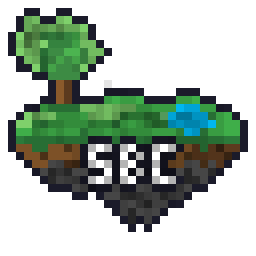

# SkyBlock Companion

### One mod for all of Hypixel SkyBlock

**[Features](docs/FEATURES.md)** · **[Gallery](docs/GALLERY.md)** · **[Commands](docs/COMMANDS.md)** · **[Install](docs/INSTALLING.md)** · **[FAQ](docs/FAQ.md)** · **[Performance](docs/PERFORMANCE.md)** · **[Changelog](docs/CHANGELOG.md)**

---

SkyBlock Companion replaces the stack of mods you would normally run with one: prices on every item, a warp menu, a minimap, trackers, helpers for every island, a profile viewer and more. One look, one settings menu, and every feature can be switched off.

## Performance

SkyBlock Companion is built to keep your FPS high. A HUD is normally drawn again every frame, which adds up with many cards on screen. This mod draws its HUD into one image 20 times a second and shows that image in between. Its helpers also look only at what they need: the empty armor stands SkyBlock places everywhere are skipped.

Recorded with `/sbc perf record` for one minute each in the same spot, on an RTX 4060 Ti and an i7-8700K, at 1080p with render distance 14:

| Location | Setup | Average FPS | 1% low | 0.1% low | SBC time per frame | Report |
| :--- | :--- | ---: | ---: | ---: | ---: | :--- |
| Private Island | SBC, performance options on | 548 | 184 | 105 | 0.20 ms | [Report](docs/performance/record-20261109-104506.txt) |
| Private Island | SBC, performance options off | 296 | 132 | 96 | 1.04 ms | [Report](docs/performance/record-20261109-105005.txt) |
| Hub bank, 47 players | SBC, performance options on | 421 | 150 | 93 | 0.26 ms | [Report](docs/performance/record-20261109-105120.txt) |

In the middle of the Hub, the same modpack without SBC runs at about 280 FPS, and popular SkyBlock modpacks at 70 to 100, read from the FPS counter. How to measure your own: [Performance](docs/PERFORMANCE.md).

## What it does

+ **Prices everywhere**: Bazaar, lowest BIN, NPC and craft prices on every tooltip, an Item List beside your inventory, and Market Search for the Bazaar and the Auction House.
+ **30+ profit trackers**: what you actually get, at live prices, per hour and per session.
+ **Every island**: Garden, Mining, Foraging, Fishing, Hunting, Crimson Isle, Rift, Dungeons, Slayers, Kuudra and every event.
+ **Helpers beside Hypixel's menus**: Accessories, Pets, Bazaar, Auction House, Storage, Party Finder and more. Hypixel's menus stay exactly as they are.
+ **HUD**: player card, scoreboard, tab list, minimap, health and skill bars. You can edit everything in the HUD editor: press **H** in game.
+ **The menu**: opens with **K**. Your day, a planner, money methods, minions, the Forge, and a profile viewer for anyone.
+ **Travel**: warp menu, island map, a path line to any NPC or place, waypoints.
+ **Chat**: 80 filters, compact messages and your own rules.

See **[all features](docs/FEATURES.md)**.

See **[all commands](docs/COMMANDS.md)**.

## Getting started

1. Install [Fabric Loader](https://fabricmc.net/use/installer/) for the Minecraft version on the download page.
2. Download [Fabric API](https://modrinth.com/mod/fabric-api) for the same version and put it in your `mods` folder.
3. Download the mod from [CurseForge](https://www.curseforge.com/minecraft/mc-mods/sbc-hypixel-skyblock-companion) or [GitHub](https://github.com/Skyblock-Companion/SBC/releases/latest) and put it in your `mods` folder too.
4. Start the game. A short setup runs the first time, then press **K**.

More in the [install guide](docs/INSTALLING.md).

## Discord and support

Questions, bugs and ideas: the [Discord server](https://discord.gg/QrqX3pgVW2) or the [issues](https://github.com/Skyblock-Companion/SBC/issues). For a bug, type `/sbc dump` in game and attach the file. The [FAQ](docs/FAQ.md) answers the common questions, including what the mod sends and where.

## Credits

Made by **zMuzy**, with AI assistance.

Huge thanks to **SkyHanni**, **Skyblocker**, **NotEnoughUpdates**, **SkyHelper** and everyone in the mod's credits screen. Much of the mod's logic and data come from their open source code, credited in the source and in [THIRD_PARTY_NOTICES.md](THIRD_PARTY_NOTICES.md). The design and the look are SkyBlock Companion's own.

Licensed under **GPL-3.0**. Images and map data keep their own CC BY-NC-SA licences.
