# Gallery

SkyBlock Companion in the game. Pick a picture to jump to it, and use **Previous** and **Next** to go through them in order.

[Back to the README](../README.md)

## Contents

<table>
<tr>
<td align="center" valign="top"><a href="#k-menu">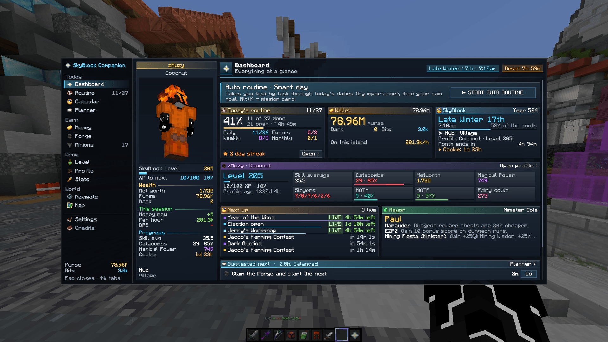</a> K menu</td>
<td align="center" valign="top"><a href="#profile-viewer">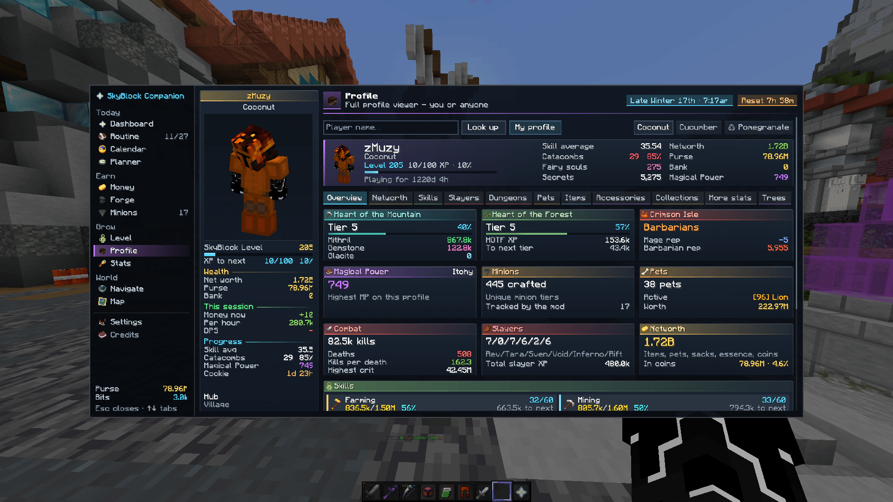</a> Profile viewer</td>
<td align="center" valign="top"><a href="#money">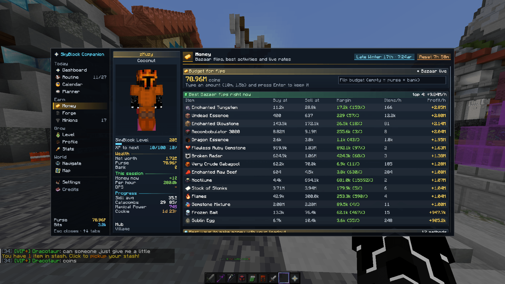</a> Money</td>
<td align="center" valign="top"><a href="#settings">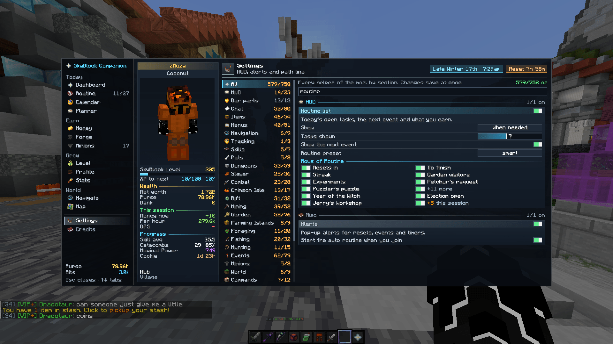</a> Settings</td>
</tr>
<tr>
<td align="center" valign="top"><a href="#player-card">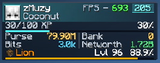</a> Player card</td>
<td align="center" valign="top"><a href="#tab-list-scoreboard-and-minimap">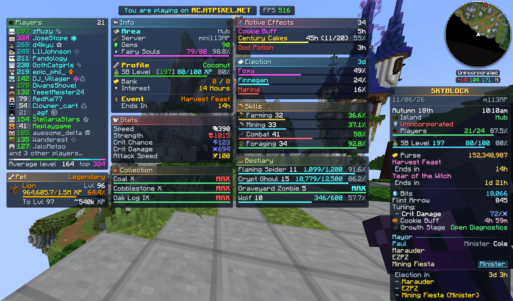</a> Tab list, scoreboard and minimap</td>
<td align="center" valign="top"><a href="#garden-hud">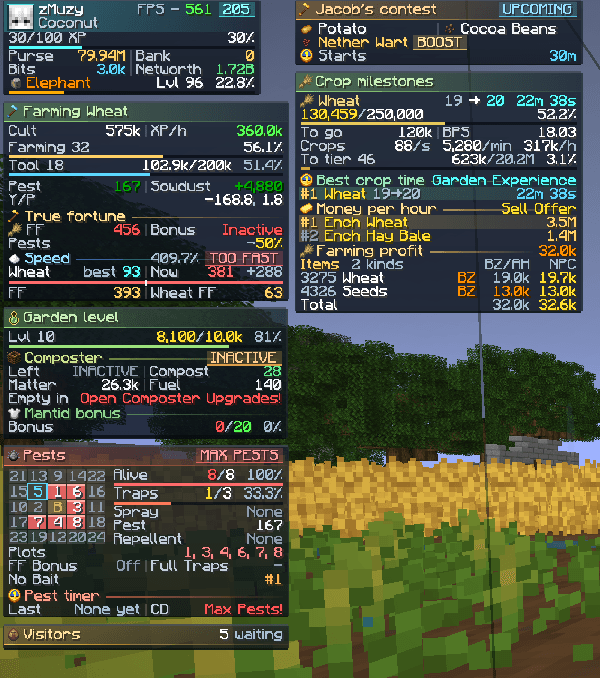</a> Garden HUD</td>
<td align="center" valign="top"><a href="#slayer-hud">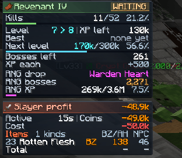</a> Slayer HUD</td>
</tr>
<tr>
<td align="center" valign="top"><a href="#witch-ingredients">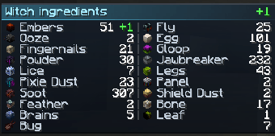</a> Witch ingredients</td>
<td align="center" valign="top"><a href="#storage">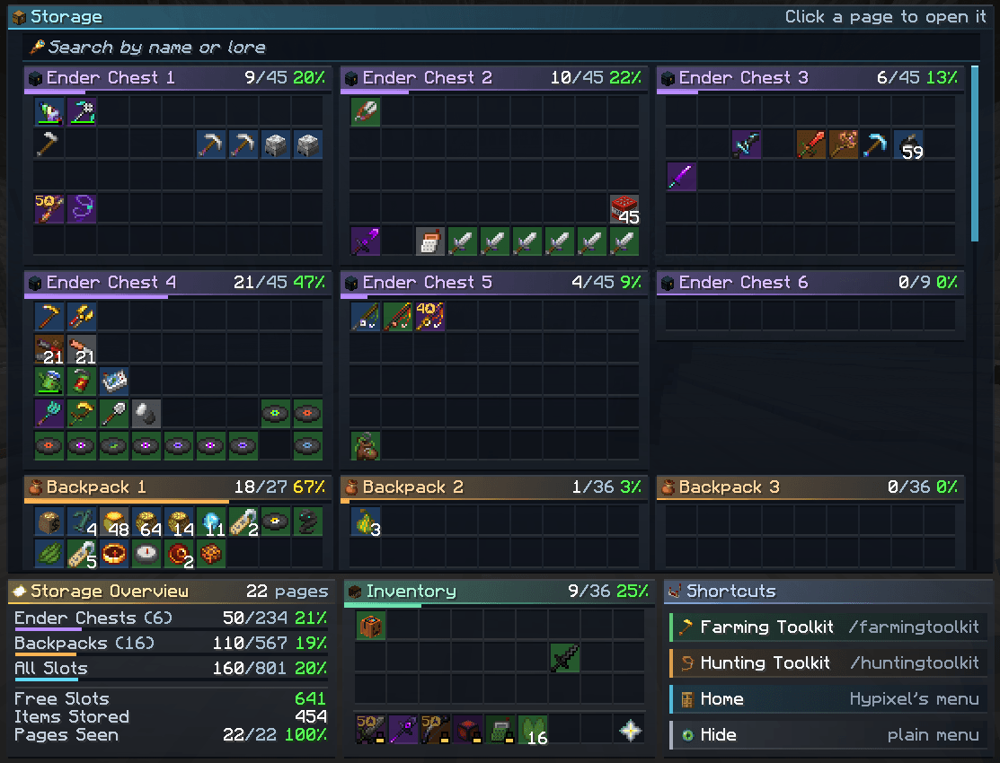</a> Storage</td>
<td align="center" valign="top"><a href="#party-finder">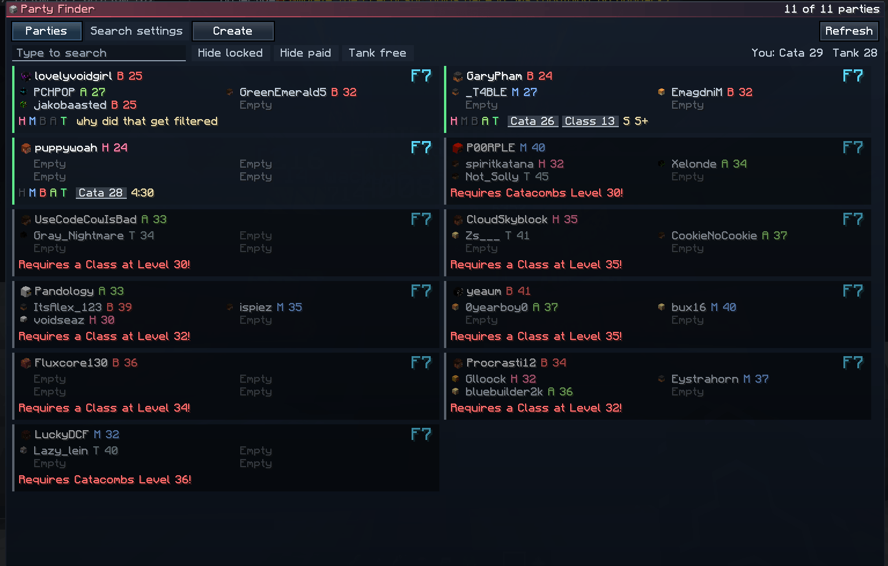</a> Party Finder</td>
<td align="center" valign="top"><a href="#market-search">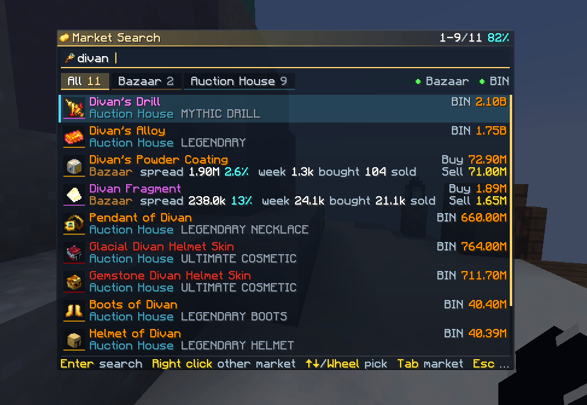</a> Market search</td>
</tr>
<tr>
<td align="center" valign="top"><a href="#bazaar-helper">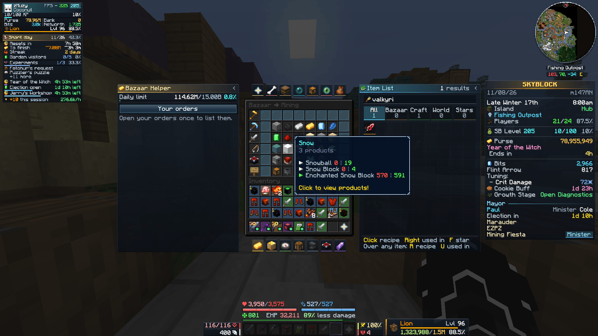</a> Bazaar Helper</td>
<td align="center" valign="top"><a href="#buy-helper">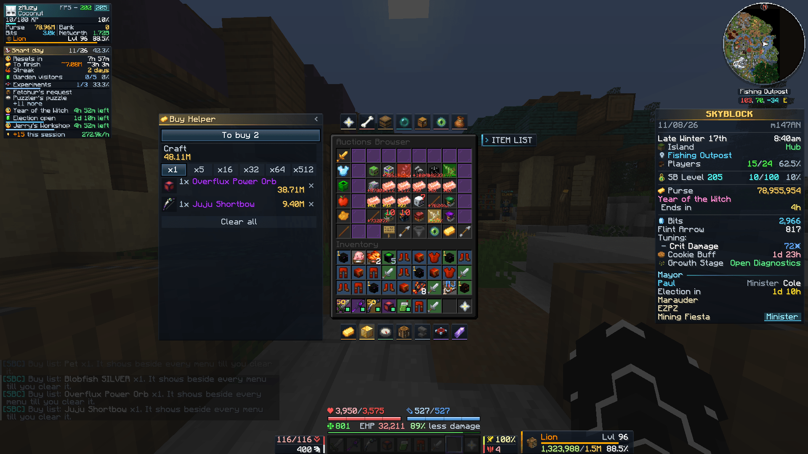</a> Buy Helper</td>
<td align="center" valign="top"><a href="#sack-helper">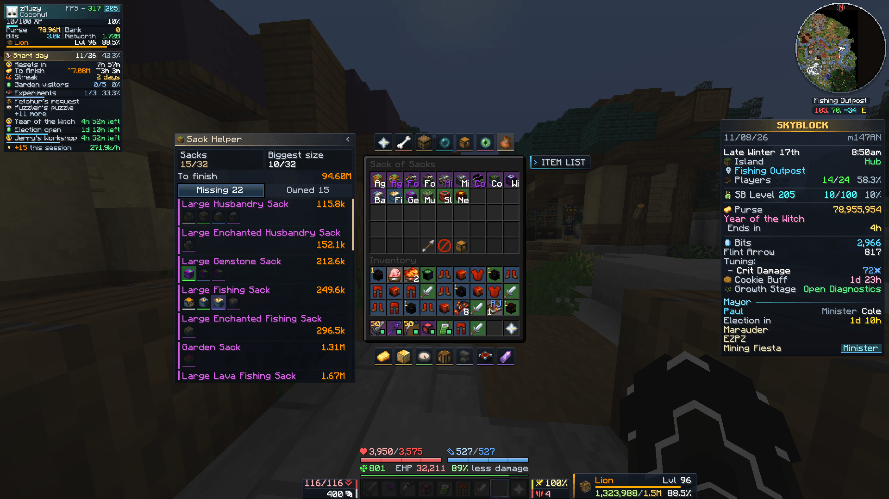</a> Sack Helper</td>
<td align="center" valign="top"><a href="#accessory-helper">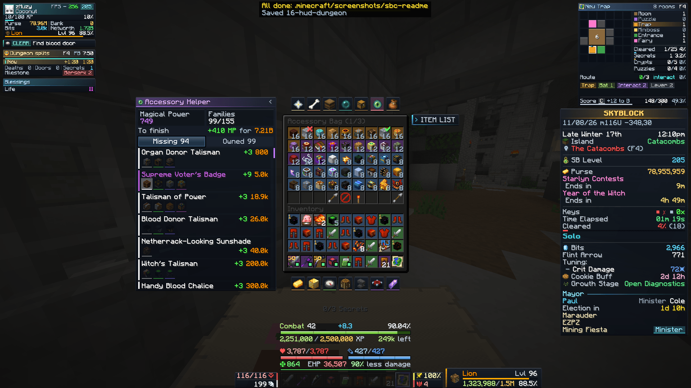</a> Accessory Helper</td>
</tr>
<tr>
<td align="center" valign="top"><a href="#pet-helper">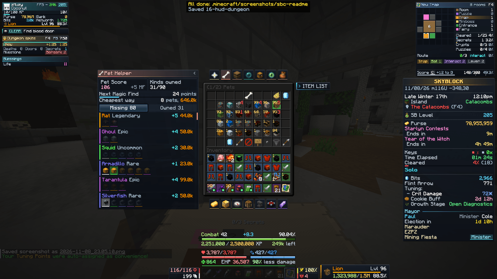</a> Pet Helper</td>
<td align="center" valign="top"><a href="#year-of-the-witch-helper">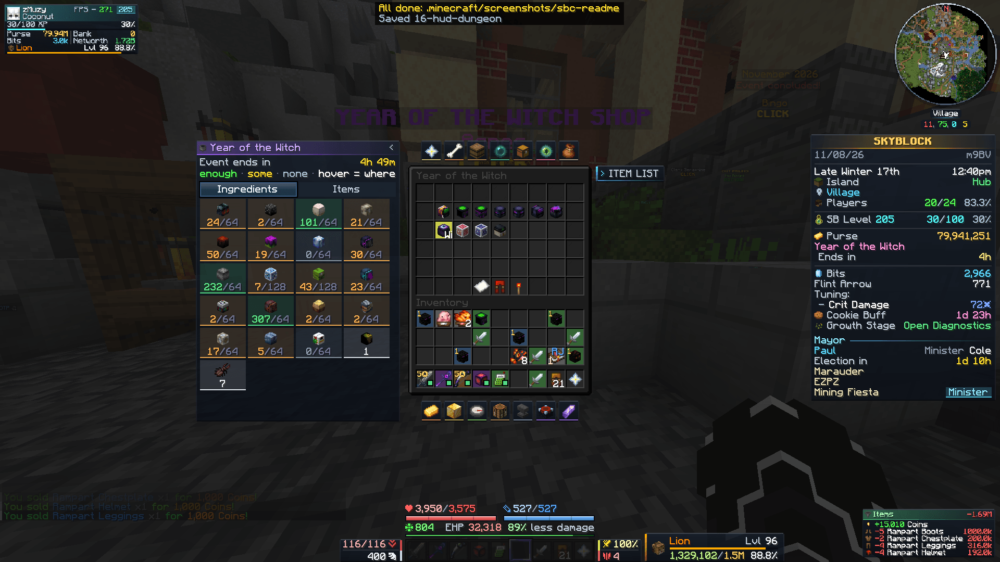</a> Year of the Witch Helper</td>
<td align="center" valign="top"><a href="#warp-menu">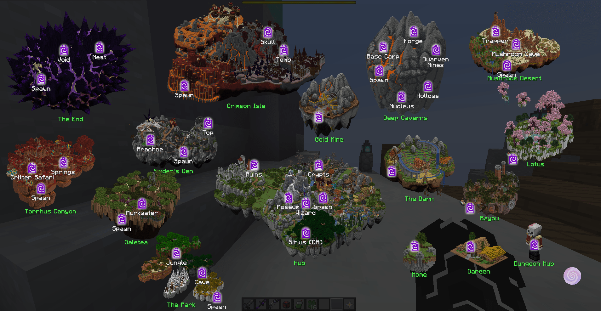</a> Warp menu</td>
<td align="center" valign="top"><a href="#item-list">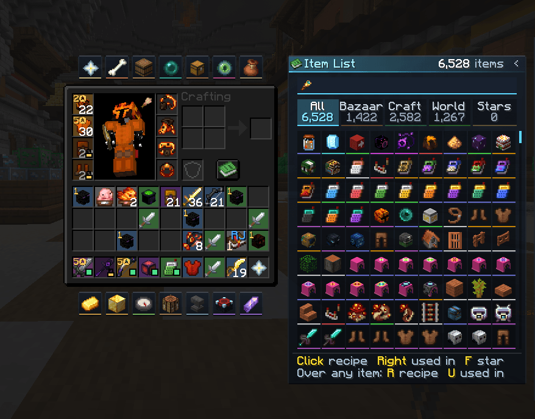</a> Item List</td>
</tr>
</table>

## The K menu

### K menu

Press **K** for the dashboard: today's routine and how far you are, your purse and bank, the events coming up, the mayor and a suggested next step.

1 of 20 · Previous · [Contents](#contents) · [Next: Profile viewer](#profile-viewer)

### Profile viewer

`/pv` with any name, or your own profile: skills, slayers, dungeons, pets, items, accessories, collections and networth, each on its own tab.

2 of 20 · [Previous: K menu](#k-menu) · [Contents](#contents) · [Next: Money](#money)

### Money

Bazaar flips for the budget you set, with the buy and sell price, the margin, how many sell an hour and the profit an hour. Below them, ways to make money with what your profile has.

3 of 20 · [Previous: Profile viewer](#profile-viewer) · [Contents](#contents) · [Next: Settings](#settings)

### Settings

Every helper of the mod, sorted by section, with a search. Changes save at once.

4 of 20 · [Previous: Money](#money) · [Contents](#contents) · [Next: Player card](#player-card)

## HUD

### Player card

Your name and profile, FPS, SkyBlock level and XP, purse, bits, bank, networth, and your pet with its level.

5 of 20 · [Previous: Settings](#settings) · [Contents](#contents) · [Next: Tab list, scoreboard and minimap](#tab-list-scoreboard-and-minimap)

### Tab list, scoreboard and minimap

The tab list in sections: players, area, profile, stats, pet, skills, collections, effects, the election and the bestiary. Next to it the scoreboard and the minimap.

6 of 20 · [Previous: Player card](#player-card) · [Contents](#contents) · [Next: Garden HUD](#garden-hud)

### Garden HUD

Farming speed and fortune, the next Jacob's contest, crop milestones, money per hour, the Garden level, the composter, pests by plot and the visitors waiting.

7 of 20 · [Previous: Tab list, scoreboard and minimap](#tab-list-scoreboard-and-minimap) · [Contents](#contents) · [Next: Slayer HUD](#slayer-hud)

### Slayer HUD

The slayer quest: kills until the boss, your slayer level, bosses left, the RNG drop you are going for and the RNG meter. Under it, what the session earned and cost.

8 of 20 · [Previous: Garden HUD](#garden-hud) · [Contents](#contents) · [Next: Witch ingredients](#witch-ingredients)

### Witch ingredients

During Year of the Witch, the ingredients you carry. A green + marks what you picked up this session.

9 of 20 · [Previous: Slayer HUD](#slayer-hud) · [Contents](#contents) · [Next: Storage](#storage)

## Menus

### Storage

Every Ender Chest and backpack on one screen, with how full each one is. Search by name or lore and open a page with a click.

10 of 20 · [Previous: Witch ingredients](#witch-ingredients) · [Contents](#contents) · [Next: Party Finder](#party-finder)

### Party Finder

Dungeon parties as cards: the floor, each member's class and level, and what the party asks for. Filters hide locked and paid parties or show only the ones that need a tank.

11 of 20 · [Previous: Storage](#storage) · [Contents](#contents) · [Next: Market search](#market-search)

### Market search

One search for the Bazaar and the Auction House, instead of the vanilla one. It also opens with **Y**, and shows the price, the spread and how much sold this week.

12 of 20 · [Previous: Party Finder](#party-finder) · [Contents](#contents) · [Next: Bazaar Helper](#bazaar-helper)

### Bazaar Helper

Beside the Bazaar: your daily limit and your orders. Hover an item and press **J** to add it to the buy list. Garden visitors add what they ask for when you open them.

13 of 20 · [Previous: Market search](#market-search) · [Contents](#contents) · [Next: Buy Helper](#buy-helper)

### Buy Helper

In the Auction House, **J** adds an item to the buy list as well. The list shows what is left to buy and what it costs.

14 of 20 · [Previous: Bazaar Helper](#bazaar-helper) · [Contents](#contents) · [Next: Sack Helper](#sack-helper)

### Sack Helper

Beside the Sack of Sacks: the sacks you are missing, cheapest first, the ones you own and what it costs to finish.

15 of 20 · [Previous: Buy Helper](#buy-helper) · [Contents](#contents) · [Next: Accessory Helper](#accessory-helper)

### Accessory Helper

The accessories you are missing, with the Magical Power each one adds and its price, and what it costs to finish.

16 of 20 · [Previous: Sack Helper](#sack-helper) · [Contents](#contents) · [Next: Pet Helper](#pet-helper)

### Pet Helper

The pets you are missing, with the pet score each one adds and its price, and the cheapest way to the next Magic Find bonus.

17 of 20 · [Previous: Accessory Helper](#accessory-helper) · [Contents](#contents) · [Next: Year of the Witch Helper](#year-of-the-witch-helper)

### Year of the Witch Helper

Beside the Witch's Sack: every ingredient and how many you have. Hover one to see which mob drops it.

18 of 20 · [Previous: Pet Helper](#pet-helper) · [Contents](#contents) · [Next: Warp menu](#warp-menu)

## Getting around

### Warp menu

Every island as a picture, with its warps on it. Click one to go there.

19 of 20 · [Previous: Year of the Witch Helper](#year-of-the-witch-helper) · [Contents](#contents) · [Next: Item List](#item-list)

### Item List

Every SkyBlock item, with Bazaar, crafting and World tabs. Click an item for its recipe, right-click for what it is used in, and press **F** to star it.

20 of 20 · [Previous: Warp menu](#warp-menu) · [Contents](#contents) · Next
